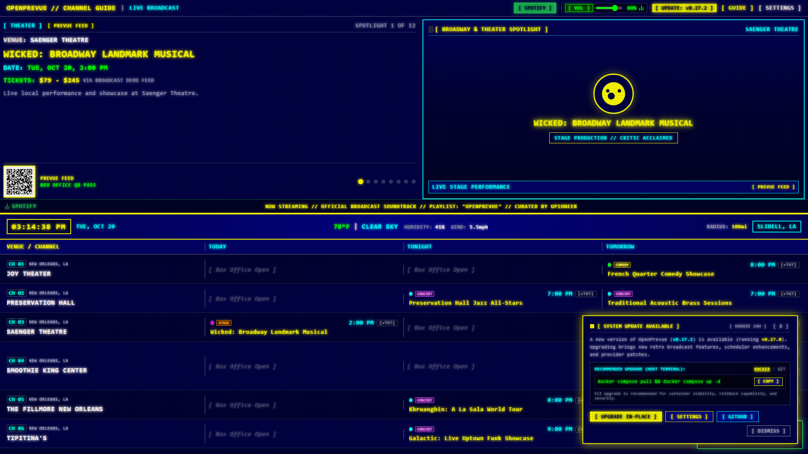
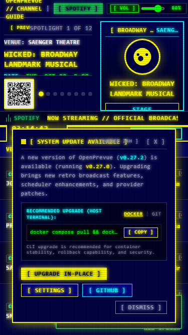
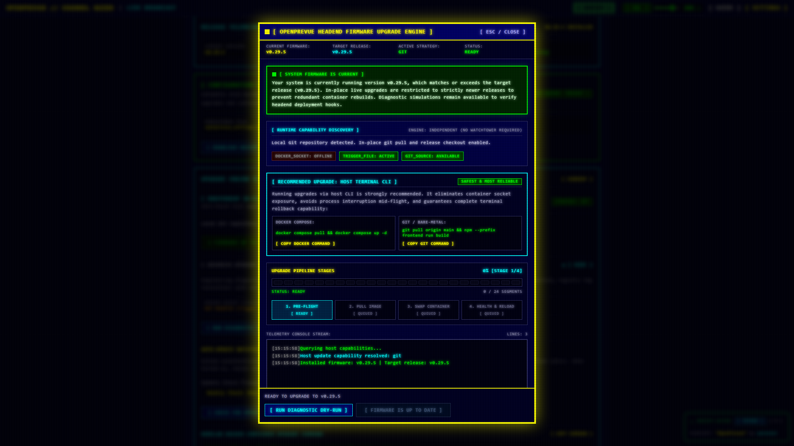
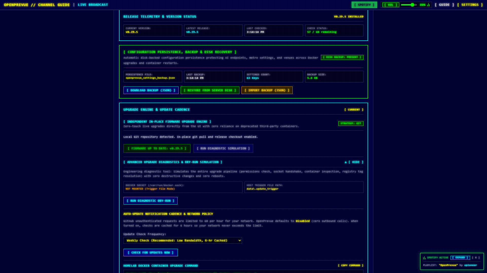
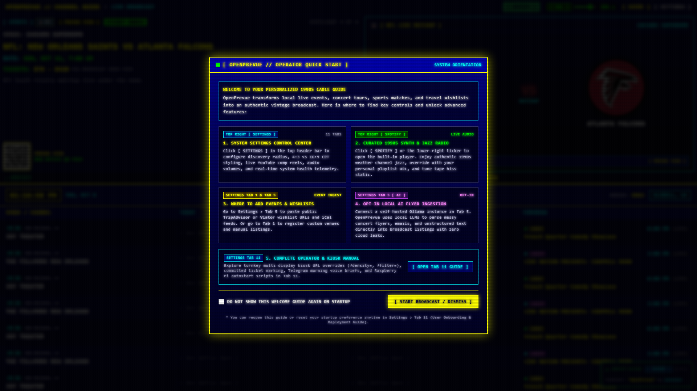
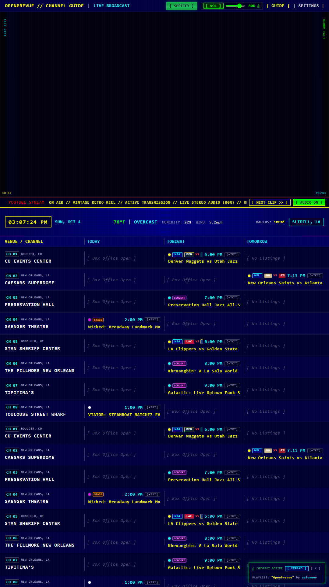

# Release v0.30.0: Calendar-Anchored Event Architecture, Rolling EPG Timeline & 1-Click CLI Update Guidance

## Overview
Release v0.30.0 delivers major architectural upgrades to OpenPrevue event ingestion, timeline scheduling, and system update operations. The event pipeline transitions from fragile sliding timestamp offsets to a calendar-anchored, timezone-aware multi-day model spanning Today, Tomorrow, and the next 7 days. The EPG grid introduces an automated 5:00 PM evening transition (Approach 2) that shifts timeline columns and resolves future weekdays dynamically. Additionally, the update subsystem is enhanced with persistent dismissible notifications, ambient kiosk popup suppression, and 1-click terminal CLI update guidance for Docker and Git environments.

## What is New & Improved in v0.30.0

### 1. Calendar-Anchored Multi-Day Event Architecture
* **Date-Anchored Fixture Keys:** In [`mock.py`](file:///C:/Users/hgran/OneDrive/Documents/code/Projects/OpenPrevue/backend/app/providers/mock.py) and [`ticketing.py`](file:///C:/Users/hgran/OneDrive/Documents/code/Projects/OpenPrevue/backend/app/providers/ticketing.py), synthetic and ticketed events are generated with deterministic date-stamped identifiers (`{slug}-{YYYY-MM-DD}`). This guarantees persistent event identity across server reboots.
* **Full Multi-Day Coverage:** Providers now reliably generate fixtures across Today, Tomorrow, and the upcoming 7-day schedule in the headend's declared timezone ([`resolve_app_timezone()`](file:///C:/Users/hgran/OneDrive/Documents/code/Projects/OpenPrevue/backend/app/services/ingestion.py)), resolving the defect where tomorrow consistently showed zero events in portrait and 2-column configurations.
* **Live ESPN Multi-Date Ingestion:** In [`sports.py`](file:///C:/Users/hgran/OneDrive/Documents/code/Projects/OpenPrevue/backend/app/providers/sports.py), live scoreboards query both today and tomorrow (`?dates=YYYYMMDD`), normalize game start times to the local application timezone, and deduplicate venue matchups.
* **Calendar Date Boundary Filtering:** In [`events.py`](file:///C:/Users/hgran/OneDrive/Documents/code/Projects/OpenPrevue/backend/app/api/v1/endpoints/events.py) and [`ingestion.py`](file:///C:/Users/hgran/OneDrive/Documents/code/Projects/OpenPrevue/backend/app/services/ingestion.py), queries filter events from the start of the local calendar day rather than sliding hourly windows, preventing premature event disappearance.
* **Legacy Fixture Migration:** Included automated purge routines (`purge_legacy_undated_fixtures()`) to remove undated legacy fixtures during sync passes.

### 2. Rolling Window Timeline Grid Evening Transition
* **EPG Evening Cutoff (17:00 / 5:00 PM):** In [`TimelineGrid.vue`](file:///C:/Users/hgran/OneDrive/Documents/code/Projects/OpenPrevue/frontend/src/components/TimelineGrid.vue), reactive evening detection rolls timeline columns forward when local time reaches 5:00 PM:
  * **2-Day Mode:** Column 1 transitions from `TODAY` to `TONIGHT` (highlighting tonight's evening events and ticketed reservations), while Column 2 continues displaying `TOMORROW`.
  * **3-Day Mode:** Column 1 shifts to `TONIGHT`, Column 2 shifts to `TOMORROW`, and Column 3 advances to the next calendar weekday name (for example, `WEDNESDAY` or `THURSDAY`).
* **UTC-Safe Weekday Formatting:** Dynamic weekday calculation uses UTC noon calendar math to guarantee headers never drift across day boundaries due to local UTC offset conversions.
* **Curated Channel Filter Alignment:** The active venue filter evaluates dynamic slots (`slot1`, `slot2`, `slot3`), ensuring channels with upcoming evening or next-day events remain visible in the rotation.

### 3. Portrait Sports Matchup Visual Rebalancing
* **Centered Split Viewports:** In [`SpotlightPane.vue`](file:///C:/Users/hgran/OneDrive/Documents/code/Projects/OpenPrevue/frontend/src/components/SpotlightPane.vue), replaced top-and-bottom hugging layout with two balanced `flex-1` centering viewports flanking a centered `shrink-0` VS divider.
* **Edge Clearance:** Sports cards in vertical 9:16 portrait displays sit centered within their upper and lower halves rather than clinging to the top and bottom borders.

### 4. Dismissible Update Notifications & 1-Click CLI Guidance
* **Respectful Notification Toast:** In [`UpdateToast.vue`](file:///C:/Users/hgran/OneDrive/Documents/code/Projects/OpenPrevue/frontend/src/components/UpdateToast.vue), notifications can be dismissed permanently for the active release version via `localStorage` (`openprevue_dismissed_update`).
* **24-Hour Snooze:** Added a `[ SNOOZE 24H ]` action for operators who want a reminder the next day.
* **Kiosk & Ambient TV Suppression:** Update toasts are automatically suppressed when running with `?kiosk=1`, preserving uninterrupted retro broadcasts on dedicated displays and CRT televisions.
* **1-Click Terminal CLI Commands:** Embedded interactive copyable CLI blocks directly inside [`UpdateToast.vue`](file:///C:/Users/hgran/OneDrive/Documents/code/Projects/OpenPrevue/frontend/src/components/UpdateToast.vue), [`UpdateModal.vue`](file:///C:/Users/hgran/OneDrive/Documents/code/Projects/OpenPrevue/frontend/src/components/UpdateModal.vue), and [`SettingsView.vue`](file:///C:/Users/hgran/OneDrive/Documents/code/Projects/OpenPrevue/frontend/src/views/SettingsView.vue) with instant clipboard copying:
  * Docker: `docker compose pull && docker compose up -d`
  * Git: `git pull origin main && npm --prefix frontend run build`
* **Automated Weekly Update Probe:** Updated [`seeder.py`](file:///C:/Users/hgran/OneDrive/Documents/code/Projects/OpenPrevue/backend/app/services/seeder.py) and [`updater.py`](file:///C:/Users/hgran/OneDrive/Documents/code/Projects/OpenPrevue/backend/app/services/updater.py) to enable weekly update checks with 6-hour rate-limit caching and on-boot detection.

### 5. Automated Verification & Testing
* **Update Toast Viewport Test:** Verified desktop and mobile notification layouts, copy buttons, and white-space boundaries via [`test_update_toast.py`](file:///C:/Users/hgran/OneDrive/Documents/code/Projects/OpenPrevue/project_details/playbooks/test_update_toast.py).
* **Firmware Modal Diagnostics Test:** Verified modal layout and CLI callout cards via [`test_update_modal_ui.py`](file:///C:/Users/hgran/OneDrive/Documents/code/Projects/OpenPrevue/project_details/playbooks/test_update_modal_ui.py).
* **Timezone & Ticketing Test Suite:** Verified date-anchored multi-day fixtures in [`test_app_timezone.py`](file:///C:/Users/hgran/OneDrive/Documents/code/Projects/OpenPrevue/tests/test_app_timezone.py) and [`test_sports_and_ticketing.py`](file:///C:/Users/hgran/OneDrive/Documents/code/Projects/OpenPrevue/tests/test_sports_and_ticketing.py).
* **Full Backend Pytest Suite:** All 103 unit and integration tests passed cleanly.

## Visual Verification & Layout Showcase

### Update Toast Notification (Desktop Viewport)

### Update Toast Notification (Mobile Viewport)

### Update Modal with Terminal CLI Callout

### Settings System Diagnostics Tab

### Dashboard Landscape Overview

### Dashboard Portrait Overview

