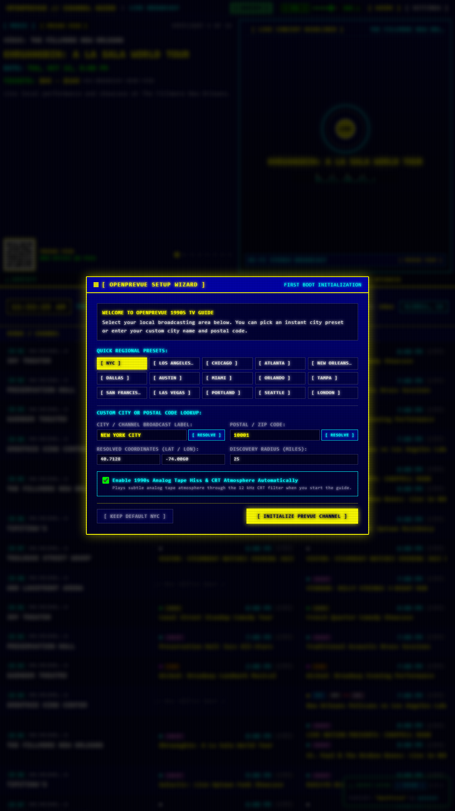
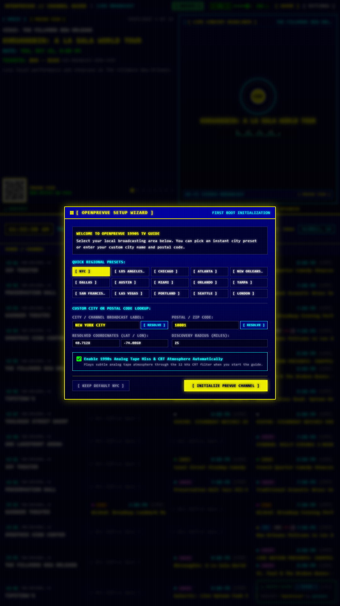
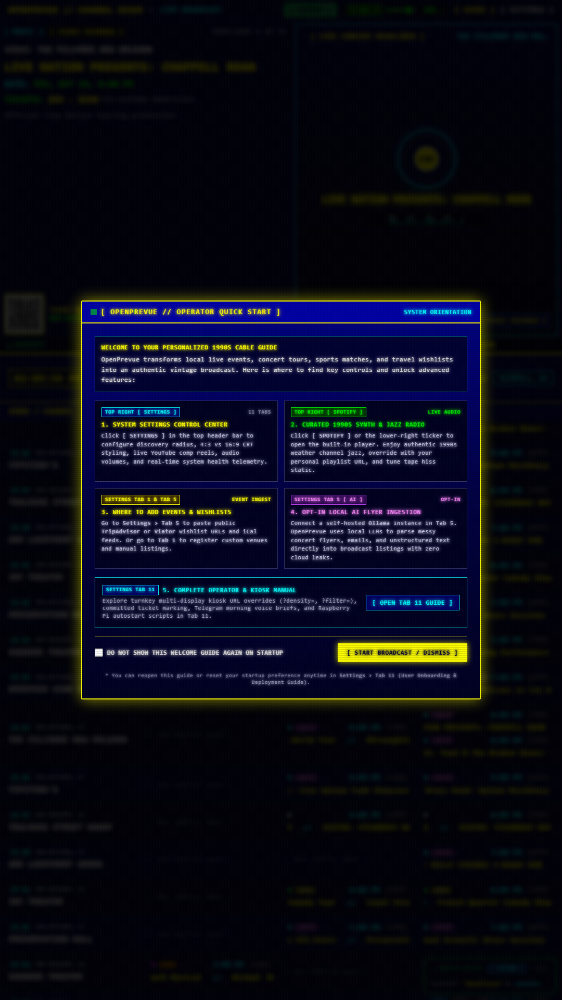
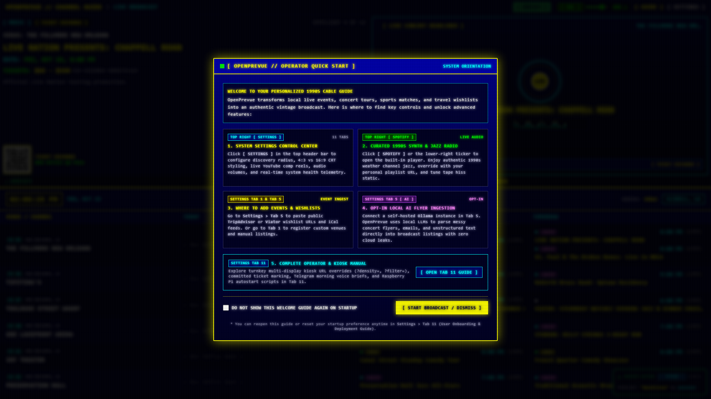
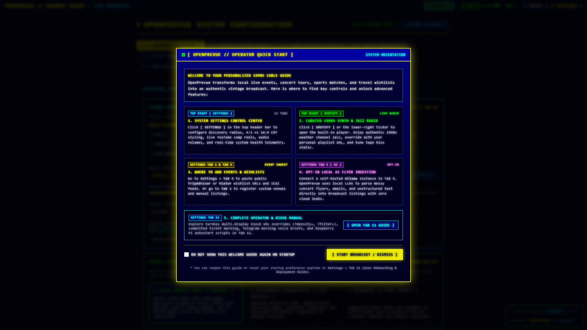
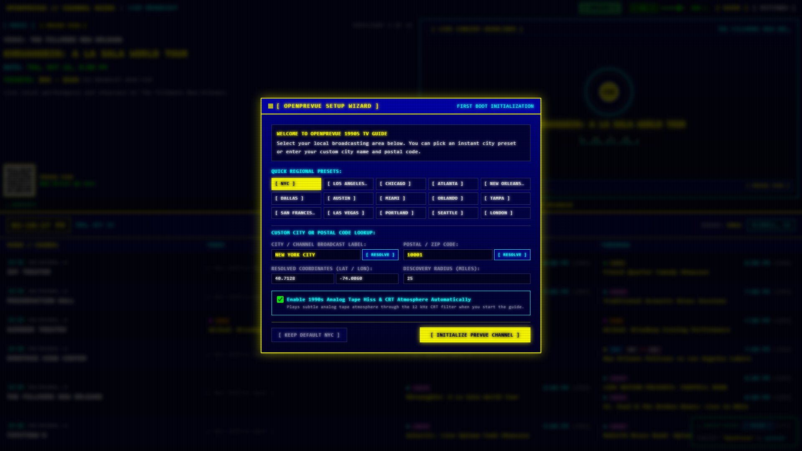

# Release v0.30.1: Universal Multi-Day Fixture Ingestion, Timezone-Safe Calendar Boundaries & Multi-Day Kiosk Reliability

## Overview
Release v0.30.1 resolves a critical, persistent defect where secondary calendar columns (such as "Tomorrow" in portrait orientation or 2-day/3-day multi-column grids) displayed zero events, showing `[ Box Office Open ]` placeholders across channels while "Today" was fully populated. Rather than applying a local cosmetic workaround, this release systematically eliminates six root causes spanning backend scheduling, database query semantics, venue coordinate drift, onboarding timezone synchronization, and provider fixture generation. These comprehensive fixes ensure robust multi-day fixture availability across all Docker container deployments and local installations regardless of timezone, geographic location, or screen aspect ratio.

## Detailed Root Causes and Architectural Solutions

### 1. Scheduler Startup Ingestion Omission
* **Root Cause:** In [`scheduler.py`](file:///C:/Users/hgran/OneDrive/Documents/code/Projects/OpenPrevue/backend/app/services/scheduler.py), the background job `JOB_ID_SYNC` was registered using an APScheduler `IntervalTrigger(hours=6)`. Interval triggers wait for a full interval duration (6 hours) before firing their first execution. While startup routines purged expired events, the scheduler never performed an immediate fixture ingestion upon boot.
* **Resolution:** Added an immediate asynchronous task invocation (`asyncio.create_task(execute_scheduled_sync())`) upon scheduler startup. Any freshly booted Docker container or restarted instance immediately executes a full provider sync pass without waiting 6 hours.

### 2. Seeder Tomorrow Fixture Guard
* **Root Cause:** In [`seeder.py`](file:///C:/Users/hgran/OneDrive/Documents/code/Projects/OpenPrevue/backend/app/services/seeder.py), the database seeder guarded ingestion behind `if event_count == 0:`. If a container restarted with even a single stale or legacy event surviving in the database, the seeder skipped initialization entirely, leaving tomorrow's schedule completely starved.
* **Resolution:** Replaced the crude count check with an explicit tomorrow verification query. The seeder now inspects the database specifically for active fixtures matching tomorrow's local calendar date. If zero fixtures exist for tomorrow, it immediately initiates [`sync_all_registered_providers()`](file:///C:/Users/hgran/OneDrive/Documents/code/Projects/OpenPrevue/backend/app/services/ingestion.py).

### 3. SQLite `date()` UTC Shift Bug
* **Root Cause:** SQLite's built-in `date('YYYY-MM-DDTHH:MM:SS-05:00')` function automatically converts ISO timestamps with timezone offsets to UTC before returning the date portion. Because evening concerts and games in North American timezones (such as Central Time -05:00 or Pacific Time -08:00) start at 7:00 PM (19:00 local = 00:00 UTC), SQLite converted evening showtimes to the *following* calendar day. Consequently, queries filtering with `WHERE date(start_time) = :date` silently discarded all evening events from the local calendar day.
* **Resolution:** Replaced all SQLite `date(start_time)` invocations in [`events.py`](file:///C:/Users/hgran/OneDrive/Documents/code/Projects/OpenPrevue/backend/app/api/v1/endpoints/events.py) and [`ingestion.py`](file:///C:/Users/hgran/OneDrive/Documents/code/Projects/OpenPrevue/backend/app/services/ingestion.py) with string prefix matching: `substr(start_time, 1, 10)` and `start_time LIKE :pattern`. This preserves the intended local calendar date string exactly as authored by ingestion providers without UTC date drift.

### 4. Venue Coordinate Drift and Radius Filtering
* **Root Cause:** In [`ingestion.py`](file:///C:/Users/hgran/OneDrive/Documents/code/Projects/OpenPrevue/backend/app/services/ingestion.py) within [`_resolve_or_create_venue`](file:///C:/Users/hgran/OneDrive/Documents/code/Projects/OpenPrevue/backend/app/services/ingestion.py), when a venue already existed by name, the system reused the existing database row without updating coordinates. When users switched geographic presets or modified headend coordinates, venues retained stale legacy coordinates. Subsequent queries to [`/api/v1/events`](file:///C:/Users/hgran/OneDrive/Documents/code/Projects/OpenPrevue/backend/app/api/v1/endpoints/events.py) calculated Haversine distances exceeding the configured search radius and silently dropped valid fixtures.
* **Resolution:** Updated [`_resolve_or_create_venue`](file:///C:/Users/hgran/OneDrive/Documents/code/Projects/OpenPrevue/backend/app/services/ingestion.py) to dynamically update latitude and longitude coordinates if provider payload coordinates differ from the stored record.

### 5. Onboarding Timezone Auto-Detection and Setting Triggers
* **Root Cause:** In [`SetupModal.vue`](file:///C:/Users/hgran/OneDrive/Documents/code/Projects/OpenPrevue/frontend/src/components/SetupModal.vue) and [`regionalPresets.ts`](file:///C:/Users/hgran/OneDrive/Documents/code/Projects/OpenPrevue/frontend/src/services/regionalPresets.ts), regional presets lacked timezone definitions, and initial wizard setup never updated the backend `timezone` setting. Non-Eastern installations were trapped in container default timezones. Furthermore, changing timezones in settings did not trigger an automatic provider re-sync.
* **Resolution:** Added explicit IANA timezone identifiers to all presets in [`regionalPresets.ts`](file:///C:/Users/hgran/OneDrive/Documents/code/Projects/OpenPrevue/frontend/src/services/regionalPresets.ts) alongside an automatic browser fallback (`Intl.DateTimeFormat().resolvedOptions().timeZone`). In [`settings.py`](file:///C:/Users/hgran/OneDrive/Documents/code/Projects/OpenPrevue/backend/app/api/v1/endpoints/settings.py), added `"timezone"` to the reactive keys that trigger provider re-sync and broadcast WebSocket `events_updated` signals.

### 6. Full 7-Day Rolling Calendar Provider Schedule
* **Root Cause:** Synthetic and mock event generators in [`mock.py`](file:///C:/Users/hgran/OneDrive/Documents/code/Projects/OpenPrevue/backend/app/providers/mock.py) generated fixtures exclusively for the current day (`day_offset = 0`), leaving tomorrow and subsequent days empty when running in offline or mock environments.
* **Resolution:** Expanded [`mock.py`](file:///C:/Users/hgran/OneDrive/Documents/code/Projects/OpenPrevue/backend/app/providers/mock.py) to synthesize rolling multi-day fixtures across a continuous 7-day schedule (`day_offset` 0 through 6) across all major regional presets (New Orleans, New York, Los Angeles, Chicago, and generic metro setups). Extended rolling schedule support in [`ticketing.py`](file:///C:/Users/hgran/OneDrive/Documents/code/Projects/OpenPrevue/backend/app/providers/ticketing.py) and [`sports.py`](file:///C:/Users/hgran/OneDrive/Documents/code/Projects/OpenPrevue/backend/app/providers/sports.py).

## Automated Verification and Test Suite

* **Startup Cadence Integration Test:** Added [`test_startup_cadence.py`](file:///C:/Users/hgran/OneDrive/Documents/code/Projects/OpenPrevue/tests/test_startup_cadence.py) verifying immediate ingestion scheduling upon startup and seeder tomorrow fixture replenishment.
* **Playwright Kiosk Verification:** Created and executed [`verify_portrait_tomorrow_fixtures.py`](file:///C:/Users/hgran/OneDrive/Documents/code/Projects/OpenPrevue/project_details/playbooks/verify_portrait_tomorrow_fixtures.py) in 1080x1920 portrait orientation, confirming both 2-day (`TODAY` + `TOMORROW`) and 3-day multi-column grids render fully populated fixtures with zero box-office placeholder gaps.
* **Full Backend Pytest Suite:** All 106 backend tests passed cleanly.
* **Production Build Validation:** Executed `vue-tsc && vite build` confirming zero TypeScript or bundle compilation errors.

## Visual Verification and Evidence Showcase

### Portrait Mode 2-Column Fixtures (Today + Tomorrow Verified)

### Portrait Mode 3-Column Fixtures (Multi-Day Grid Verified)

### Dashboard Portrait Kiosk Display

### Dashboard Landscape Overview

### Settings Control Center

### Regional Setup Wizard Modal

